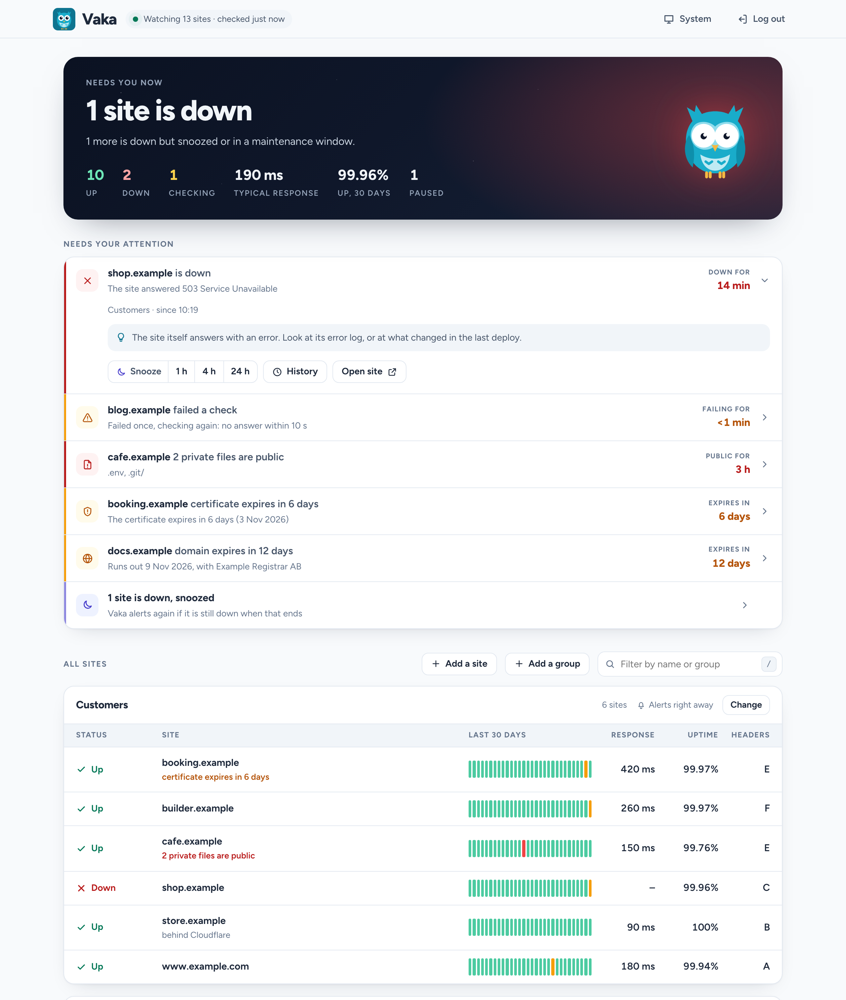
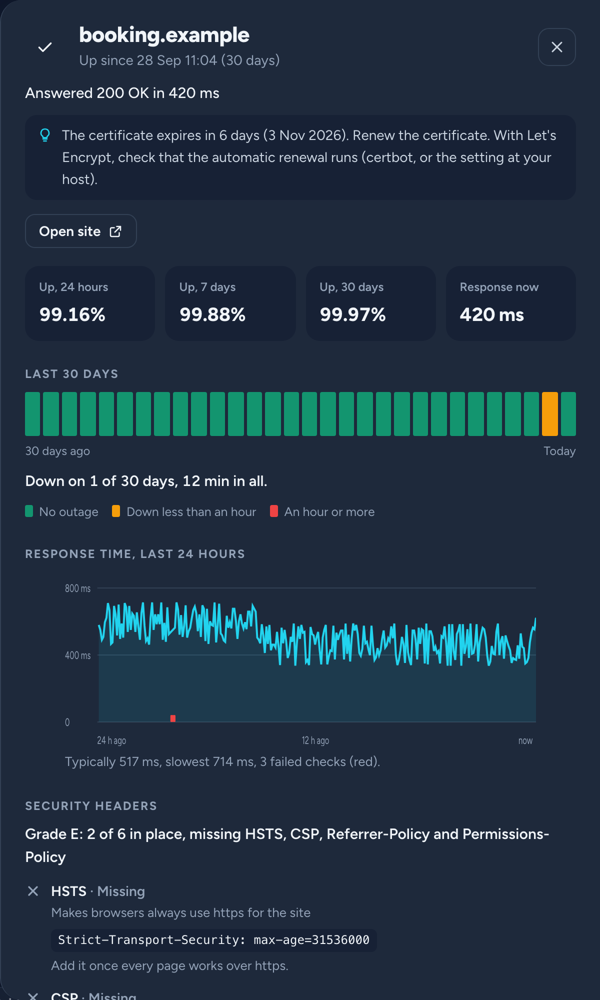
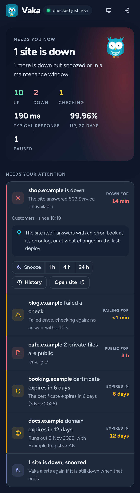

<div align="center">


# Vaka

**Keeps watch while you sleep.**

Uptime, response times and certificates for every site, plus domains, exposed files and security headers.<br>
One cron line, no dependencies, and one alert when a whole server goes down.

[](https://github.com/webready-se/vaka/actions/workflows/tests.yml)
[](LICENSE)

</div>

<picture>
  <source media="(prefers-color-scheme: dark)" srcset="docs/screenshots/dashboard.png">
  
</picture>

> **Status:** Vaka watches Webready's own and our customers' sites in production. The first release (0.1.0, a zip with only the files that run) is on the [roadmap](ROADMAP.md); until then, install from a clone of this repository.

## Get started

On a server with PHP 8.3 or newer and cron:

```bash
git clone https://github.com/webready-se/vaka.git && cd vaka
php vaka user:add admin              # press Enter for a strong password
php vaka site:add https://shop.example
php vaka run                         # check now
php -S localhost:8080 -t public      # try the dashboard, or point your web server at public/
```

Then run it every minute from cron (the dashboard shows the exact line for your server):

```cron
* * * * * php /path/to/vaka/vaka run >> /dev/null 2>&1
```

Run Vaka on a different server than the sites it watches: if that server goes down, nothing could tell you. Laravel Forge and shared hosting, with or without SSH, are covered in [Install](docs/install.md).

## What makes it different

- **One message, not fifty.** When a server goes down, Vaka sends one alert for every site on it, and one when it is back. Most monitors send one alert per site.

  > 🔴 **Server web-1 (203.0.113.10) is not answering: all 6 sites are down**<br>
  > shop.example, www.example.com, booking.example, cafe.example, builder.example, deals1.example<br>
  > No answer within 10 s
  >
  > 🟢 **Server web-1 (203.0.113.10) is back: 6 sites up again after 19 min**

- **Snooze, and nothing is forgotten.** Already on it? Snooze the incident for an hour, four hours or a day. A site that stays down is brought up again every four hours, and if it is still down when a snooze ends, you hear about it again.
- **Rules per group.** Each group has its own Slack channel and alert policy: right away, after a few minutes down, a daily summary, or dashboard only. Maintenance windows (one-off or every night) keep planned work quiet while the checks keep recording.
- **Watches for things getting worse.** Exposed `.env` files, Git folders and database dumps, security headers that disappear, and mail records that change. Checked every day, with an alert when something changes, not a one-off scan.
- **Plain language.** The dashboard leads with what is wrong right now and what to do about it. Every number is explained; the detail is one click away.

## Everything it checks

- **Uptime and response time**, with an optional keyword that must be on the page. Down after two failures in a row, so one hiccup does not wake anyone, and a failing site is checked again every minute.
- **SSL certificates**, the way a browser sees them: a warning at 14, 7 and 1 days before they expire, and when they turn invalid.
- **Domain expiry** through RDAP, the registries' own structured data, and WHOIS for .se and .nu.
- **Exposed files** like `.env`, `.git/`, database dumps and backup zips, matched on their content, so a site that answers 200 for everything does not cry wolf.
- **Security headers** graded A to F, with what each one does and the line to add.
- **Mail DNS:** MX, SPF and DMARC, with the record to add when one is missing, and an alert when they change.

Everything is also in a [read API](docs/api.md), as JSON or CSV, with a read-only token per site or group: for your own reports, for a customer, or for the AI assistant in a site's own project.

Alerts go to Slack, a JSON webhook or email. Sites behind Cloudflare and other CDNs are recognised and alerted on their own, since they share the CDN's addresses with unrelated sites.

<details>
<summary>More screenshots</summary>

**A site's detail:** uptime over 24 hours, 7 and 30 days, response times, its security headers and its history



**On a phone**



**Light mode**


</details>

## Why self-host it

- **Copy the files, add a cron line.** PHP 8.3+ and SQLite. No framework, no Composer packages at runtime, no build step, no CDN. It runs on Laravel Forge and on shared hosting.
- **Stays maintainable.** Nothing to upgrade except PHP itself.
- **Strict by default.** A strict Content Security Policy, CSRF tokens, login lockout and access per group. Vaka's own headers get an A in its own check.
- **Stores little.** No personal data; response times are kept for 30 days (`SAMPLES_RETENTION_DAYS`).
- **Watched itself.** Every run pings a heartbeat URL of your choice, such as Healthchecks.io's free tier, so you hear about it when Vaka stops. `/?health` answers 503 when the runs have stopped, and the dashboard says so too.

## How Vaka compares

| | What you run | Set up in | Database | License |
|---|---|---|---|---|
| **Vaka** | PHP 8.3 files and one cron line, also on shared hosting | The dashboard for sites, the command line for the rest ([more is coming](ROADMAP.md)) | SQLite, built in | MIT |
| [Uptime Kuma](https://github.com/louislam/uptime-kuma) | Node.js 20.4+, or Docker | A web interface | SQLite, or MariaDB since 2.0 | MIT |
| [Gatus](https://github.com/TwiN/gatus) | A Go binary, or Docker | A YAML file | In memory, SQLite or PostgreSQL | Apache 2.0 |
| [UptimeRobot](https://uptimerobot.com) | Nothing, they host it. Free: 50 monitors every 5 min, for hobby and non-profit projects | A web interface | Their servers | Proprietary |
| [Better Stack](https://betterstack.com/uptime) | Nothing, they host it. Free: 10 monitors | A web interface | Their servers | Proprietary |

<sub>From each project's own documentation, October 2026. Corrections are welcome as issues or pull requests.</sub>

**When to pick something else.** Vaka is made for agencies and developers who run their own and their customers' sites.

- Checks from many places in the world, or phone calls and an on-call rota: a hosted service such as UptimeRobot or Better Stack. Vaka checks from the one server it runs on.
- Many kinds of monitors (TCP ports, ping, DNS, Docker containers, push) and everything set up in a web interface: Uptime Kuma.
- Monitoring as code, kept in Git, with conditions on API responses: Gatus.

## Documentation

- [Install](docs/install.md): Laravel Forge, shared hosting with and without SSH, cron, the heartbeat
- [Configuration](docs/configuration.md): every `.env` setting and every CLI command
- [Checks](docs/checks.md): what each check looks at and when it runs
- [Alerts](docs/alerts.md): when alerts go out, where they go, policies, maintenance, snooze, and the JSON webhook's fields
- [Read API](docs/api.md): JSON and CSV with a read token, also for [your AI assistant](docs/api.md#use-it-from-an-ai-assistant)
- [Changelog](CHANGELOG.md) and [roadmap](ROADMAP.md)

## License

MIT. Made by [Webready](https://webready.se) in Sweden, sibling of [Puls](https://github.com/webready-se/puls). The dashboard uses the Figtree typeface, under the SIL Open Font License (`public/fonts/OFL.txt`).
